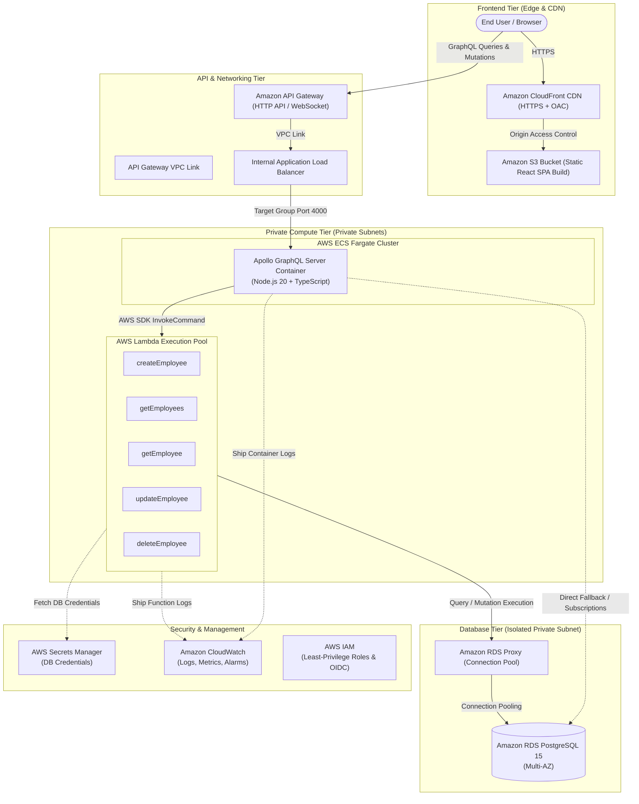

# AWS DevOps Assessment: Serverless GraphQL Architecture with RDS Integration

[](.github/workflows)
[](docs/architecture.md)
[](backend/)
[](frontend/)
[](database/)

---

## 📋 Executive Project Summary

This project delivers a **production-grade, scalable serverless GraphQL architecture on AWS**, integrated with automated CI/CD pipelines and managed database storage via **Amazon RDS PostgreSQL**.

The application implemented is an **Enterprise Employee Management System** featuring:
- **GraphQL Queries**: Fetch all employees (with department/status filters and pagination), fetch employee by ID, and service health check.
- **GraphQL Mutations**: Create new employee, update employee details, and delete employee.
- **GraphQL Subscriptions**: Real-time WebSocket notifications (`graphql-ws`) on employee creation, updates, and deletion.

---

## 🏛️ System Architecture



---

## 📁 Repository Structure

```
.
├── frontend/                     # React 18 + Vite + Apollo Client SPA
│   ├── src/
│   │   ├── apollo/client.ts      # Apollo Client with HTTP & WebSocket links
│   │   ├── components/           # Navbar, StatsCard, EmployeeList, Modals, Toast
│   │   ├── graphql/              # Typed Queries, Mutations, Subscriptions
│   │   ├── types/                # Domain TypeScript models
│   │   ├── App.tsx               # Main dashboard component
│   │   └── main.tsx              # Application entry point
│   ├── package.json
│   └── vite.config.ts
│
├── backend/                      # Apollo GraphQL Server 4 on Express
│   ├── src/
│   │   ├── schema/typeDefs.ts    # Complete GraphQL schema definition
│   │   ├── resolvers/            # Query, Mutation, and Subscription resolvers
│   │   ├── services/             # AWS SDK Lambda Invocation & DB service fallback
│   │   └── index.ts              # Express + Apollo + WebSocket + Health check
│   ├── Dockerfile                # Multi-stage non-root container definition
│   └── package.json
│
├── lambda/                       # 5 AWS Lambda Functions (TypeScript)
│   ├── common/                   # Shared connection pooling, types & Secrets Manager
│   ├── createEmployee/           # Insert employee into RDS
│   ├── getEmployees/             # Select employees with filters & pagination
│   ├── getEmployee/              # Select employee by ID
│   ├── updateEmployee/           # Dynamic UPDATE employee by ID
│   ├── deleteEmployee/           # DELETE employee by ID
│   ├── build.js                  # Fast esbuild bundler (zero-node_modules zip bundles)
│   └── package.json
│
├── database/                     # PostgreSQL DDL & Seed Data
│   ├── schema.sql                # Table DDL, UUIDs, Indexes, update triggers
│   └── seed.sql                  # Initial mock dataset
│
├── .github/workflows/            # Automated CI/CD Pipelines
│   ├── frontend-deploy.yml       # Test, Vite build, S3 sync, CloudFront invalidation
│   └── backend-deploy.yml        # ECR Docker build/push, ECS deploy, Lambda update
│
├── scripts/                      # Local validation and build automation
│   ├── validate.ps1 / .sh        # Validates all package builds and typechecks
│   └── ...
│
├── docs/                         # In-depth enterprise documentation suite
│   ├── architecture.md           # Network topology and service interactions
│   ├── deployment-guide.md       # Step-by-step AWS Management Console manual guide
│   ├── security.md               # IAM least-privilege matrix, Secrets Manager, OAC
│   ├── cicd.md                   # GitHub Actions OIDC and workflow architecture
│   ├── monitoring.md             # CloudWatch alarms, metrics, and thresholds
│   ├── rollback.md               # Runbooks for ECS, Lambda, Frontend, and DB
│   ├── cleanup.md                # Cost control and teardown checklist
│   └── interview-qa.md           # DevOps interview preparation guide
│
├── docker-compose.yml            # Local full-stack runtime (Postgres + Backend + Frontend)
├── PROGRESS.md                   # Assessment execution tracker
└── README.md
```

---

## 🚀 Quickstart: Running Locally

### 1. Run Complete Stack with Docker Compose
Run all 3 services (PostgreSQL + Apollo Server + React UI) with a single command:
```bash
docker compose up --build
```
- **Frontend UI**: [http://localhost:3000](http://localhost:3000)
- **GraphQL HTTP & Playground**: [http://localhost:4000/graphql](http://localhost:4000/graphql)
- **Container Health Check**: [http://localhost:4000/health](http://localhost:4000/health)
- **PostgreSQL**: `localhost:5432` (`user: postgres`, `password: postgrespassword`, `database: employeedb`)

### 2. Validate All Code Locally (Zero-Error Verification)
```powershell
# Windows PowerShell
.\scripts\validate.ps1
```
```bash
# Linux / macOS
./scripts/validate.sh
```

---

## 📖 Assessment Documentation Links
- [Detailed System Architecture & Diagrams](docs/architecture.md)
- [Step-by-Step AWS Console Manual Deployment Guide](docs/deployment-guide.md)
- [IAM Security, Secrets Manager & Network Security](docs/security.md)
- [CI/CD Pipeline with GitHub Actions & OIDC](docs/cicd.md)
- [CloudWatch Monitoring, Metrics & Alarms](docs/monitoring.md)
- [Automated & Manual Rollback Strategies](docs/rollback.md)
- [AWS Resource Cleanup & Cost Optimization Guide](docs/cleanup.md)
