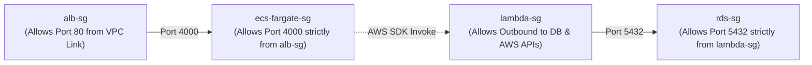

# AWS Services Deep Dive & Infrastructure Configuration Guide

This document is your **authoritative, plain-English reference** explaining **every AWS service** used in this project, what it does, and **why each specific setting** was configured during infrastructure creation.

---

## Quick Navigation Index

1. [Amazon VPC (Virtual Private Cloud) & Networking](#1-amazon-vpc-virtual-private-cloud--networking)
2. [AWS IAM (Identity and Access Management)](#2-aws-iam-identity-and-access-management)
3. [AWS Secrets Manager](#3-aws-secrets-manager)
4. [Amazon RDS (Relational Database Service) - PostgreSQL](#4-amazon-rds-relational-database-service---postgresql)
5. [AWS Lambda (Serverless Compute)](#5-aws-lambda-serverless-compute)
6. [Amazon ECR (Elastic Container Registry)](#6-amazon-ecr-elastic-container-registry)
7. [Amazon ECS (Elastic Container Service) with AWS Fargate](#7-amazon-ecs-elastic-container-service-with-aws-fargate)
8. [Elastic Load Balancing: Internal ALB & Target Group](#8-elastic-load-balancing-internal-alb--target-group)
9. [Amazon API Gateway & VPC Link](#9-amazon-api-gateway--vpc-link)
10. [Amazon S3 (Simple Storage Service)](#10-amazon-s3-simple-storage-service)
11. [Amazon CloudFront (CDN) & Origin Access Control](#11-amazon-cloudfront-cdn--origin-access-control)
12. [Amazon CloudWatch (Logs, Metrics & Alarms)](#12-amazon-cloudwatch-logs-metrics--alarms)

---

# 1. Amazon VPC (Virtual Private Cloud) & Networking

### What is Amazon VPC in Simple Words?
Amazon VPC is your own **private, isolated virtual data center** in the AWS Cloud. By default, resources in AWS are on shared infrastructure. VPC gives you a private fenced-off slice of the cloud where only your servers and databases can talk to each other under strict networking rules you define.

---

### Every Setting Explained:

#### 1. VPC Name: `devops-assessment-vpc`
- **What it is:** The human-readable identifier for your private network.

#### 2. IPv4 CIDR Block: `10.0.0.0/16`
- **What it is:** **Classless Inter-Domain Routing**. It defines the range of IP addresses available in your VPC.
- **Why `10.0.0.0/16`:** The `/16` subnet mask gives you **65,536 private IP addresses** (`10.0.0.0` through `10.0.255.255`). This provides massive headroom to carve up subnets for web, containers, lambdas, and databases without running out of IP addresses.

#### 3. DNS Resolution & DNS Hostnames: `Enabled`
- **What it is:** Enables AWS internal DNS server to translate domain names (like `*.rds.amazonaws.com`) into private IP addresses.
- **Why Enabled:** RDS PostgreSQL instances only provide DNS endpoints (e.g., `devops-employee-rds.c7isqqei086h.ap-south-1.rds.amazonaws.com`). If DNS resolution is disabled, your ECS containers and Lambda functions cannot resolve the database address.

---

### Subnets Explained (Public vs. Private):

A **Subnet** is a sliced-up subsection of your VPC's IP pool restricted to a specific physical Availability Zone (AZ) data center.

| Subnet Name | CIDR Block | AZ | Type | What Lives Here & Why |
|---|---|---|---|---|
| `public-subnet-1a` | `10.0.1.0/24` | `ap-south-1a` | **Public** | NAT Gateway lives here. Has a direct route to the Internet Gateway. |
| `public-subnet-1b` | `10.0.2.0/24` | `ap-south-1b` | **Public** | Redundant public subnet for Multi-AZ compliance. |
| `private-app-subnet-1a` | `10.0.11.0/24` | `ap-south-1a` | **Private** | **Internal ALB & ECS Fargate Containers**. No public IPs. Outbound internet routed via NAT Gateway. |
| `private-app-subnet-1b` | `10.0.12.0/24` | `ap-south-1b` | **Private** | Multi-AZ secondary subnet for high availability. |
| `private-lambda-subnet-1a`| `10.0.21.0/24` | `ap-south-1a` | **Private** | **AWS Lambda Functions**. Communicates with RDS privately and calls AWS services via NAT Gateway. |
| `private-lambda-subnet-1b`| `10.0.22.0/24` | `ap-south-1b` | **Private** | Multi-AZ secondary subnet for Lambda high availability. |
| `private-db-subnet-1a` | `10.0.31.0/24` | `ap-south-1a` | **Isolated** | **PostgreSQL RDS Primary**. No internet access whatsoever (no IGW, no NAT). |
| `private-db-subnet-1b` | `10.0.32.0/24` | `ap-south-1b` | **Isolated** | PostgreSQL RDS Failover/Standby subnet (required by AWS Subnet Groups). |

- **Why `/24` mask?** Each subnet gets **256 IP addresses** (251 usable, as AWS reserves 5). More than enough for our containers and Lambda ENIs.

---

### Gateways & Route Tables Explained:

#### 1. Internet Gateway (IGW): `devops-igw`
- **What it is:** A horizontally scaled, redundant software router attached to the VPC.
- **Why it's used:** Connects the VPC to the outside internet. Without an IGW, no traffic can enter or leave the VPC.

#### 2. NAT Gateway: `devops-nat-gw`
- **What it is:** **Network Address Translation Gateway**.
- **Where it lives:** Must be deployed inside a **Public Subnet** (`public-subnet-1a`) and attached to an **Elastic IP (EIP)**.
- **Why it's used:** Private resources (like ECS Fargate tasks and Lambda functions) have no public IP addresses. When they need to reach external services (e.g., pulling Docker images from ECR, calling AWS Secrets Manager, sending CloudWatch logs), the NAT Gateway translates their private IP to its public Elastic IP, fetches the external data, and passes it back safely without exposing the private servers to incoming internet traffic.

#### 3. Route Tables (The Traffic Rules):
- **Public Route Table (`public-rt`):**
  - Route: `0.0.0.0/0` ➔ `Target: devops-igw`
  - *Purpose:* Any packet destined for the outside world goes straight to the Internet Gateway.
- **Private App Route Table (`private-app-rt`):**
  - Route: `0.0.0.0/0` ➔ `Target: devops-nat-gw`
  - *Purpose:* ECS Fargate tasks send outbound traffic through the NAT Gateway.
- **Private Lambda Route Table (`private-lambda-rt`):**
  - Route: `0.0.0.0/0` ➔ `Target: devops-nat-gw`
  - *Purpose:* Lambda functions send outbound traffic through the NAT Gateway.
- **Private DB Route Table (`private-db-rt`):**
  - Route: Only local (`10.0.0.0/16 ➔ local`). **NO 0.0.0.0/0 route!**
  - *Purpose:* Absolute database isolation. The database can NEVER talk to the internet, and the internet can NEVER talk to the database.

---

### Security Groups (Virtual Stateful Firewalls) Explained:

A **Security Group** acts as a virtual firewall for your instances to control inbound and outbound traffic at the network interface level. **Security Groups are stateful** (if an inbound request is permitted, the outbound response is automatically allowed).



#### 1. `alb-sg` (Application Load Balancer Security Group)
- **Inbound Rule:** Port `80` (HTTP) from `10.0.0.0/16` (or VPC Link).
- **Outbound Rule:** All traffic (`0.0.0.0/0`) to route traffic to ECS containers.
- **Why:** The ALB only accepts HTTP traffic from within the VPC Link and forwards it to ECS tasks.

#### 2. `ecs-fargate-sg` (ECS Container Security Group)
- **Inbound Rule:** Port `4000` strictly from Source: `alb-sg`.
- **Outbound Rule:** All traffic (`0.0.0.0/0`) through NAT Gateway.
- **Why:** **Zero-Trust Security**. Even within the private VPC, the container rejects any connection on port 4000 that does not come directly from the Load Balancer.

#### 3. `lambda-sg` (Lambda Security Group)
- **Inbound Rule:** None (Lambdas are triggered via AWS control plane, not incoming TCP sockets).
- **Outbound Rule:** Port `5432` to `rds-sg`, and HTTPS `443` to reach Secrets Manager / CloudWatch.
- **Why:** Grants Lambda functions permission to connect out to RDS PostgreSQL.

#### 4. `rds-sg` (Database Security Group)
- **Inbound Rule:** Port `5432` (PostgreSQL) strictly from Source: `lambda-sg`.
- **Outbound Rule:** None.
- **Why:** Ensures that **only Lambda functions** can execute SQL queries against the database. No EC2 instance, no container, and no external IP can establish a database connection.

---

# 2. AWS IAM (Identity and Access Management)

### What is IAM in Simple Words?
IAM is the **security guard and passport office** of AWS. By default, AWS services cannot talk to each other. IAM creates **Roles** (identity badges) and **Policies** (written permission rules) that dictate exactly which AWS service is authorized to do what.

---

### The Big Confusion: `ecsTaskExecutionRole` vs. `ecsTaskRole`

This is the #1 question asked in DevOps interviews. Here is the clear distinction:

```
+----------------------------------------------------------------------------+
|                         ECS Task (Fargate Container)                       |
|                                                                            |
|  [ AWS ECS Platform Agent ]                     [ Your Application Code ]  |
|  Assumes: ecsTaskExecutionRole                  Assumes: ecsTaskRole       |
|                                                                            |
|  1. Pull Docker image from ECR                  1. Calls AWS Lambda        |
|  2. Create CloudWatch Log Streams               2. Calls S3 or DynamoDB    |
|  3. Decrypt Secrets Manager variables           3. Application business    |
|                                                    logic permissions       |
+----------------------------------------------------------------------------+
```

| Role Name | Who Assumes It? | What Permissions Does It Need? | Why It's Needed in Our Project |
|---|---|---|---|
| **`ecsTaskExecutionRole`** | The **AWS ECS Agent** (the infrastructure orchestrator before your code boots). | - `ecr:GetAuthorizationToken`<br>- `ecr:BatchGetImage`<br>- `logs:CreateLogStream`<br>- `logs:PutLogEvents`<br>- `logs:CreateLogGroup` | Required so AWS can pull the container image from our private ECR repository and stream container logs into CloudWatch. |
| **`ecsTaskRole`** | **Your Node.js Application Code** (running *inside* the container). | - `lambda:InvokeFunction` on `arn:aws:lambda:ap-south-1:*:function:*` | When your Apollo GraphQL resolver executes `lambda.send(new InvokeCommand(...))`, the AWS SDK uses this role to authenticate with AWS. |
| **`lambdaExecutionRole`** | **The AWS Lambda Service** | - `AWSLambdaBasicExecutionRole` (write logs)<br>- `AWSLambdaVPCAccessExecutionRole` (create ENIs in VPC subnets)<br>- `secretsmanager:GetSecretValue` | Required so Lambda functions can join the VPC, write execution logs, and decrypt the database password. |
| **`githubActionsRole`** | **GitHub Actions CI/CD Pipeline** | - ECR push permissions<br>- ECS update permissions<br>- S3 sync & CloudFront invalidation | Uses **OpenID Connect (OIDC)** to securely deploy code from GitHub without storing static AWS access keys. |

---

# 3. AWS Secrets Manager

### What is AWS Secrets Manager in Simple Words?
It is a **digital vault** for sensitive credentials (passwords, API tokens, database keys).

### Why use Secrets Manager instead of environment variables?
1. **No Hardcoded Passwords:** Passwords never exist in plaintext in GitHub repositories, Dockerfiles, or ECS task definitions.
2. **KMS Encryption:** The secret is stored encrypted at rest using **AWS Key Management Service (KMS)** (`aws/secretsmanager`).
3. **Dynamic Decryption:** Our Lambda functions retrieve the password in memory at runtime via the AWS SDK.
4. **Secret Name Used:** `devops/rds/credentials`
   - Stores: `username`, `password`, `engine`, `host`, `port`, `dbname`.

---

# 4. Amazon RDS (Relational Database Service) - PostgreSQL

### What is Amazon RDS in Simple Words?
Instead of installing PostgreSQL manually on an EC2 virtual machine, patching the OS, and managing backups, Amazon RDS is a **fully managed database service** where AWS handles hardware provisioning, OS patches, automatic daily backups, and storage management.

---

### Every Setting Explained:

#### 1. DB Identifier: `devops-employee-rds`
- Unique name for your database cluster in the region.

#### 2. Engine: `PostgreSQL` | Version: `15.x` / `16.x`
- Open-source, enterprise-grade relational database with native JSONB support, ACID transactions, and robust indexing.

#### 3. Template: `Dev/Test` (or Free Tier)
- Disables expensive multi-AZ replication clusters during development while providing standard production capabilities.

#### 4. Instance Configuration: `db.t3.micro` (or `db.t4g.micro`)
- **What it is:** The virtual server hardware sizing running your database engine.
- **Why `db.t3.micro`:** Provides 2 vCPUs and 1 GiB RAM with burstable CPU performance. Free tier eligible (750 hours/month free).

#### 5. Storage: `gp3` (General Purpose SSD) | Allocated: `20 GiB`
- **What is gp3:** Next-generation SSD storage providing baseline performance of 3,000 IOPS and 125 MB/s throughput independently of storage capacity.
- **Enable Storage Autoscaling: Yes (Threshold: 100 GiB):**
  - *Why:* If employee data expands beyond 20 GiB, AWS automatically increases disk space without downtime or manual intervention.

#### 6. Availability & Durability: `Single-AZ`
- Deploys the database in one primary physical data center (`ap-south-1a`). In Multi-AZ production, a hot standby replica would continuously synchronize in `ap-south-1b`.

#### 7. DB Subnet Group: `devops-rds-subnet-group`
- Defines that RDS can only live within our isolated database subnets (`private-db-subnet-1a` and `private-db-subnet-1b`).

#### 8. Public Access: `No`
- **Crucial Setting:** Completely prevents AWS from assigning a public IP address to the database. The database is invisible to the public internet.

#### 9. VPC Security Group: `rds-sg`
- Firewalls the database so only Lambda functions (`lambda-sg`) can reach port `5432`.

#### 10. Database Port: `5432`
- The standard default TCP port for PostgreSQL.

#### 11. Initial Database Name: `employeedb`
- Creates the application database inside PostgreSQL during initial provisioning (alongside the default `postgres` maintenance database).

---

# 5. AWS Lambda (Serverless Compute)

### What is AWS Lambda in Simple Words?
Lambda is **event-driven, serverless compute**. You upload your code, and AWS runs it only when triggered. When no requests are being processed, zero servers are running, costing **$0.00**.

---

### Every Setting Explained:

#### 1. Runtime: `Node.js 24.x` (or Node.js 20.x)
- The execution environment and Node.js engine running the compiled JavaScript.

#### 2. Architecture: `x86_64`
- Standard 64-bit architecture compatible with our esbuild bundling.

#### 3. Handler: `index.handler`
- Tells Lambda which function in which file to execute when triggered: File `index.js`, exported function `handler`.

#### 4. Memory: `256 MB` | Timeout: `15 - 30 seconds`
- **Memory:** Allocates RAM to the execution container. CPU power scales proportionally with RAM in AWS Lambda. 256 MB gives the optimal balance of speed and cost for database queries.
- **Timeout:** Maximum time a function can run before being terminated. Database CRUD queries complete in under 50ms, so 15s provides generous headroom for cold-start connection handshakes.

#### 5. VPC Configuration:
- **VPC:** `devops-assessment-vpc`
- **Subnets:** `private-lambda-subnet-1a`, `private-lambda-subnet-1b`
- **Security Group:** `lambda-sg`
- **Why VPC is Mandatory for Lambda:** Because our RDS PostgreSQL database has **No Public Access**, a Lambda running outside the VPC cannot route packets to the database. Attaching Lambda to the VPC gives it a **Hyperplane Elastic Network Interface (ENI)** with a private IP (`10.0.21.x`) that can talk directly to RDS on port 5432.

#### 6. Environment Variables:
- `DB_SECRET_NAME`: `devops/rds/credentials`
- `DB_NAME`: `employeedb`
- *(Note: `AWS_REGION` is omitted because AWS Lambda reserves and injects it automatically).*

---

### The 6 Lambda Functions in this Project:

| Lambda Name | Purpose & Business Logic |
|---|---|
| **`initDatabase`** | Self-healing migration worker. Connects to `postgres`, creates `employeedb`, creates `employees` table, indexes, triggers, and seeds 6 records. |
| **`getEmployees`** | Executes `SELECT * FROM employees ORDER BY created_at DESC LIMIT $1 OFFSET $2;` with department/status filters. |
| **`getEmployee`** | Executes `SELECT * FROM employees WHERE id = $1;`. |
| **`createEmployee`** | Validates email uniqueness and executes parameterized `INSERT INTO employees (...) RETURNING *;`. |
| **`updateEmployee`** | Updates employee fields dynamically with SQL timestamp update. |
| **`deleteEmployee`** | Executes `DELETE FROM employees WHERE id = $1 RETURNING id;`. |

---

# 6. Amazon ECR (Elastic Container Registry)

### What is Amazon ECR in Simple Words?
ECR is your **private Docker Hub hosted on AWS**. It securely stores, manages, and versions your Docker container images.

---

### Every Setting Explained:

#### 1. Repository Name: `devops-graphql-backend`
- The namespace for your container images.

#### 2. Visibility: `Private`
- Only authorized AWS IAM roles (like `ecsTaskExecutionRole` or your GitHub Actions CI/CD role) can pull or push images.

#### 3. Tag Immutability: `Disabled` (or Enabled in strict compliance)
- When disabled, pushing `:latest` overwrites the latest pointer while preserving image digests (SHA-256).

#### 4. Image URI Format:
`977527528431.dkr.ecr.ap-south-1.amazonaws.com/devops-graphql-backend:latest`
- `977527528431`: Your AWS Account ID.
- `dkr.ecr.ap-south-1.amazonaws.com`: ECR endpoint in Mumbai.
- `devops-graphql-backend`: Repository name.
- `:latest`: Tag version.

---

# 7. Amazon ECS (Elastic Container Service) with AWS Fargate

### What is Amazon ECS in Simple Words?
ECS is AWS's **container orchestration platform** (similar to Kubernetes, but deeply integrated with AWS). It manages the lifecycle of your Docker containers: starting them, monitoring health, restarting them if they crash, and connecting them to load balancers.

---

### The 3 Core Concepts of ECS:

```
[ ECS Cluster: devops-ecs-cluster ]
  └── [ ECS Service: devops-graphql-backend-service ]
        └── Runs Tasks based on: [ Task Definition: devops-graphql-backend:1 ]
              └── Task 1 (Docker Container: apollo-server:4000)
```

---

### Every Setting Explained:

#### 1. ECS Cluster: `devops-ecs-cluster`
- **What it is:** A logical boundary grouping together your services, tasks, and infrastructure.

#### 2. Launch Type: `AWS Fargate` (vs. EC2)
- **EC2 Launch Type:** You must provision, manage, update, and pay for virtual machines (EC2) 24/7.
- **Fargate Launch Type (Serverless Containers):** You specify CPU and RAM, and **AWS manages the underlying servers**. No EC2 instances to patch, configure, or scale.

#### 3. Task Definition: `devops-graphql-backend`
- **What it is:** The **blueprint / recipe** for your application container.
- **Task CPU & Memory:** `0.25 vCPU (256 units)` and `0.5 GB (512 MB) RAM`
  - *Why:* Keeps costs minimal (~$9/month) while providing ample power because heavy processing is delegated to Lambda.
- **Network Mode:** `awsvpc`
  - *What it is:* Every single Fargate task gets its own dedicated **Elastic Network Interface (ENI)** and its own private IP address directly inside your VPC.
  - *Critical Rule:* Because of `awsvpc`, your Target Group must have Target Type = **IP addresses** (NOT *Instances*).
- **Task Role:** `ecsTaskRole` (Grants container permission to invoke Lambda).
- **Task Execution Role:** `ecsTaskExecutionRole` (Grants ECS permission to pull ECR images and create CloudWatch log streams).
- **Port Mapping:** Port `4000` (TCP, HTTP)
  - Matches Apollo Server's internal listening port.
- **Log Driver:** `awslogs`
  - Group: `/ecs/devops-graphql-backend`
  - Region: `ap-south-1`
  - Stream Prefix: `ecs`
  - Automatically captures all container stdout/stderr console output and ships it to CloudWatch.

#### 4. ECS Service: `devops-graphql-backend-service`
- **What it is:** The **manager that keeps tasks running**. If a container crashes, the Service automatically terminates it and launches a fresh one to maintain your desired capacity.
- **Desired Tasks: `1`** (Can scale to 2-5 under load).
  - *What it is:* The exact number of container copies that should be running simultaneously.
- **Subnets:** `private-app-subnet-1a`, `private-app-subnet-1b`
- **Security Group:** `ecs-fargate-sg`
- **Public IP:** `Turn OFF / Disabled`
  - *Why:* The container lives in a private subnet. Ingress is handled solely by the Internal ALB.

---

# 8. Elastic Load Balancing: Internal ALB & Target Group

### What is an Application Load Balancer in Simple Words?
An ALB is an intelligent **traffic distributor** operating at Layer 7 (HTTP/HTTPS) of the OSI model. It accepts incoming web requests and balances them across multiple healthy containers.

---

### Every Setting Explained:

#### 1. Load Balancer Scheme: `Internal` (vs. Internet-Facing)
- **Internet-Facing ALB:** Gets public IP addresses and can be hit by anyone on the internet.
- **Internal ALB:** Gets only **private IP addresses** (`10.0.11.x`). It is completely invisible to the internet.
- **Why Internal:** We chose Internal for **Zero-Trust Security**. Public users must pass through Amazon API Gateway first; they can never probe our load balancer directly.

#### 2. Listener: `HTTP : 80`
- Listens for unencrypted HTTP traffic inside the private VPC forwarded from API Gateway's VPC Link.

#### 3. Target Group: `ecs-graphql-tg`
- **What it is:** The pool of destination endpoints that the ALB forwards traffic to.
- **Target Type: `IP addresses` (Mandatory for Fargate!):**
  - Fargate tasks run in `awsvpc` network mode, meaning they have private IP addresses, not EC2 instance IDs. Selecting *Instances* will fail.
- **Port:** `4000` | **Protocol:** `HTTP`
- **Health Check Path:** `/health`
  - *What it is:* The ALB sends a `GET /health` request to each container every 30 seconds.
  - *Success Code:* `200`
  - *Healthy Threshold: 2* (Must succeed twice consecutively to be marked Healthy).
  - *Unhealthy Threshold: 3* (If 3 health checks fail, the ALB stops sending traffic to that container and ECS replaces it).

---

# 9. Amazon API Gateway & VPC Link

### What is Amazon API Gateway in Simple Words?
API Gateway is a **managed public front door** for applications. It handles DDoS protection, throttling, authentication, and SSL termination at scale before traffic ever reaches your backend.

---

### Why HTTP API over REST API?
- **71% Cheaper:** HTTP APIs cost **$1.00 per million requests** vs $3.50 for REST APIs.
- **60% Lower Latency:** Stripped-down core proxy engine designed specifically for fast container and serverless routing.

---

### Every Setting Explained:

#### 1. VPC Link: `devops-vpc-link`
- **What it is:** A high-speed private tunnel bridging API Gateway into your private VPC subnets without needing public IPs.
- **Subnets:** `private-app-subnet-1a`, `private-app-subnet-1b`
- **Security Group:** `alb-sg`

#### 2. HTTP API: `devops-graphql-api`
- **Route:** `ANY /{proxy+}`
  - *What it is:* A **greedy catch-all route**. Any HTTP method (`GET`, `POST`, `OPTIONS`) and any path (`/health`, `/graphql`) is captured and forwarded to the backend.
- **Integration:**
  - Type: **Private Resource** ➔ ALB/NLB
  - Load Balancer: `devops-internal-alb`
  - Listener: `HTTP 80`
  - VPC Link: `devops-vpc-link`
- **Stage: `$default` with Auto-Deploy: `Enabled`**
  - In API Gateway, changes to routes or integrations must be deployed to a stage. `$default` auto-deploy ensures any route modification takes effect immediately without manual deployment steps.
- **Invoke URL:**
  `https://9n409iamg5.execute-api.ap-south-1.amazonaws.com`
  - The public HTTPS endpoint accessible from the internet.

---

# 10. Amazon S3 (Simple Storage Service)

### What is Amazon S3 in Simple Words?
S3 is **infinite cloud object storage**. It stores static files (HTML, JavaScript, CSS, images) with 99.999999999% (11 9's) durability.

---

### Every Setting Explained:

#### 1. Bucket Name: `devops-frontend-977527528431`
- Globally unique storage container name.

#### 2. Region: `ap-south-1` (Mumbai)
- Keeps the static asset origin geographically colocated with the backend and database.

#### 3. Object Ownership: `ACLs disabled (recommended)`
- Modern S3 security best practice. Disables legacy Access Control Lists; permissions are managed exclusively via IAM and Bucket Policies.

#### 4. Block Public Access: `Block ALL Public Access = ON` (All 4 Checkboxes)
- Prevents the S3 bucket from ever being made public. Direct links to S3 objects return `AccessDenied`.

#### 5. Bucket Versioning: `Enabled`
- Retains previous versions of uploaded files. If an accidental bad frontend build is uploaded, rollback is instantaneous.

#### 6. Default Encryption: `SSE-S3` (Server-Side Encryption with Amazon S3 managed keys)
- Encrypts all stored files at rest using 256-bit Advanced Encryption Standard (AES-256) at zero additional cost.

#### 7. Bucket Policy (Origin Access Control Permission):
```json
{
  "Version": "2012-10-17",
  "Statement": {
    "Sid": "AllowCloudFrontServicePrincipalReadOnly",
    "Effect": "Allow",
    "Principal": {
      "Service": "cloudfront.amazonaws.com"
    },
    "Action": "s3:GetObject",
    "Resource": "arn:aws:s3:::devops-frontend-977527528431/*",
    "Condition": {
      "StringEquals": {
        "AWS:SourceArn": "arn:aws:cloudfront::977527528431:distribution/E..."
      }
    }
  }
}
```
- **Why this policy exists:** While the bucket blocks all public access, this policy explicitly carves out an exception for **only our CloudFront distribution**.

---

# 11. Amazon CloudFront (CDN) & Origin Access Control

### What is Amazon CloudFront in Simple Words?
CloudFront is a **Content Delivery Network (CDN)**. Instead of every user downloading your website from an S3 bucket in Mumbai, CloudFront caches copies of your files at **600+ edge server locations worldwide**. Users in London, Tokyo, or New York download the site from their local city in under 20 milliseconds.

---

### Every Setting Explained:

#### 1. Origin Domain: `devops-frontend-977527528431.s3.ap-south-1.amazonaws.com`
- Tells CloudFront where the original master files live.

#### 2. Origin Access Control (OAC): `devops-s3-oac` (Recommended)
- Replaces legacy Origin Access Identity (OAI).
- Uses **AWS Signature Version 4 (SigV4)** to sign requests sent from CloudFront to S3, ensuring S3 only answers requests verified as originating from our CDN.

#### 3. Viewer Protocol Policy: `Redirect HTTP to HTTPS`
- Enforces modern security. If a user types `http://...`, CloudFront automatically redirects them to secure `https://` with an SSL certificate.

#### 4. Allowed HTTP Methods: `GET, HEAD`
- Only read operations are permitted on static assets.

#### 5. Default Root Object: `index.html`
- When a user visits `https://d10mgtmt48ejxy.cloudfront.net/` without specifying a filename, CloudFront automatically serves `index.html`.

#### 6. Custom Error Responses (Single Page Application SPA Routing):
- **Error Code:** `403: Forbidden` ➔ Response Page: `/index.html` | HTTP Code: `200: OK`
- **Error Code:** `404: Not Found` ➔ Response Page: `/index.html` | HTTP Code: `200: OK`
- **Why this setting is CRITICAL:**
  - In a React Single Page Application (SPA), routing (like `/employees`, `/dashboard`) happens in the browser's JavaScript memory via React Router, not as actual folders on S3.
  - If a user refreshes their browser on a sub-route, S3 cannot find a physical file with that path and returns a 403/404 error.
  - This Custom Error Response tells CloudFront: *"Don't show an error! Return `index.html` with a 200 OK status so React can load and handle the route!"*

#### 7. Cache Invalidation: `/*`
- When you upload an updated build to S3, CloudFront edge locations might still hold cached copies of the old files. Creating an invalidation with object path `/*` clears edge caches worldwide within seconds.

---

# 12. Amazon CloudWatch (Logs, Metrics & Alarms)

### What is Amazon CloudWatch in Simple Words?
CloudWatch is the **monitoring, logging, and alerting control center** for all AWS services.

---

### Every Setting Explained:

#### 1. CloudWatch Log Groups:
- `/ecs/devops-graphql-backend`: Aggregates all Apollo Server console logs, GraphQL execution timings, and error stack traces.
- `/aws/lambda/createEmployee`: Captures execution duration, memory used, database connection pool status, and Lambda invocation logs.
- `/aws/lambda/initDatabase`: Records schema migration history and initial table seeding outputs.

#### 2. Retention Period: `7 to 14 days`
- Keeps log storage lean and prevents accumulating storage costs.

#### 3. CloudWatch Alarms:
1. **Lambda Function Errors Alarm:**
   - Metric: `AWS/Lambda` ➔ `Errors` ➔ Sum `>= 1` for 1 consecutive period of 5 minutes.
   - Purpose: Alerts immediately if any Lambda experiences an unhandled exception or database connection drop.
2. **ECS CPU Utilization Alarm:**
   - Metric: `AWS/ECS` ➔ `CPUUtilization` ➔ Average `>= 80%` for 2 periods.
   - Purpose: Triggers Auto Scaling to spin up additional Fargate tasks.
3. **RDS Database Connections Alarm:**
   - Metric: `AWS/RDS` ➔ `DatabaseConnections` ➔ `>= 80` connections.
   - Purpose: Warns of connection exhaustion before PostgreSQL exceeds its connection pool limit.

---

## 🎯 Architecture Summary Table

| Layer | AWS Service | Key Setting / Value | Why That Setting Was Chosen |
|---|---|---|---|
| **Edge** | CloudFront CDN | OAC + Redirect HTTPS + SPA Error Handling | Sub-50ms global delivery, SSL enforcement, and client-side routing support. |
| **Storage** | Amazon S3 | Block All Public Access + Versioning | Secure, private static hosting with rollback capabilities. |
| **Ingress** | API Gateway | HTTP API + VPC Link (`ANY /{proxy+}`) | 71% cost reduction, ultra-fast routing directly into private VPC. |
| **Load Balancing**| Internal ALB | Scheme: Internal + Target Type: IP addresses | Zero-trust private load balancing, mandatory for ECS Fargate `awsvpc`. |
| **Compute** | ECS Fargate | 0.25 vCPU / 0.5 GB RAM + `ecsTaskRole` | Serverless container orchestration with least-privilege Lambda invocation. |
| **Workers** | AWS Lambda | Node.js 24 + VPC Subnets + `lambda-sg` | Event-driven CRUD microservices with direct private RDS connectivity. |
| **Database** | RDS PostgreSQL | `db.t3.micro` + Single-AZ + Public Access: No | Free-tier eligible relational database completely isolated from internet. |
| **Security** | Secrets Manager | KMS Encrypted `devops/rds/credentials` | Zero hardcoded passwords; dynamically decrypted over SSL at runtime. |
| **Monitoring** | CloudWatch | Log Groups + Alarms (CPU 80%, Errors >= 1) | Centralized observability, debugging, and proactive operational alerts. |
