# CI/CD Pipeline Implementation & GitHub Actions Deep Dive Guide

This guide is your **complete reference** for the project's Continuous Integration and Continuous Deployment (CI/CD) pipelines. It explains **what the workflows do** and provides a **comprehensive keyword-by-keyword dictionary** of GitHub Actions syntax.

---

## 1. Pipeline Overview

Our project uses **GitHub Actions** with two decoupled, automated pipelines:

```mermaid
flowchart TD
    GitPush["git push origin main / master"]

    subgraph FrontendPipeline["Frontend CI/CD (.github/workflows/frontend-deploy.yml)"]
        F1["Trigger on frontend/**"] --> F2["Node.js 24 Setup & npm ci"]
        F2 --> F3["TypeScript Typecheck (tsc --noEmit)"]
        F3 --> F4["Vite Production Build (dist/)"]
        F4 --> F5["AWS OIDC Auth (Assume githubActionsRole)"]
        F5 --> F6["S3 Sync (Hashed assets + no-cache index.html)"]
        F6 --> F7["CloudFront Edge Invalidation (/*)"]
    end

    subgraph BackendPipeline["Backend CI/CD (.github/workflows/backend-deploy.yml)"]
        B1["Trigger on backend/** or lambda/**"] --> B2["Job 1: Deploy Lambdas"]
        B2 --> B3["Bundle 5 Lambdas with esbuild & zip"]
        B3 --> B4["aws lambda update-function-code"]
        B4 --> B5["Job 2: Deploy ECS (needs: deploy-lambdas)"]
        B5 --> B6["Docker Build (multi-tag: commit SHA & latest)"]
        B6 --> B7["Push to Amazon ECR"]
        B7 --> B8["aws ecs update-service --force-new-deployment"]
        B8 --> B9["aws ecs wait services-stable"]
    end

    GitPush --> FrontendPipeline
    GitPush --> BackendPipeline
```



---

## 2. GitHub Actions Syntax & Keyword Dictionary

Every GitHub Actions workflow file is written in YAML (`.yml`). Below is the exact breakdown of every keyword used across our workflow files:

### Structural Keywords:

| Keyword | What It Does in Simple Words | Project Example |
|---|---|---|
| **`name:`** | The human-friendly title shown in the GitHub **Actions** UI dashboard. | `name: Frontend CI/CD Pipeline` |
| **`on:`** | The **event trigger block**. Defines *when* GitHub should run this workflow. | `on: push: ...` |
| **`push:`** | Triggers the workflow whenever someone pushes commits to the repository. | `push:` |
| **`branches:`** | Filters the push event to execute ONLY on specific branches. | `branches: [main, master]` |
| **`paths:`** | **Smart Path Filtering**. Only triggers the workflow if files inside these folders changed. If you only edit `frontend/`, the backend workflow will NOT run (saves build time & money!). | `paths: ['frontend/**']` |
| **`workflow_dispatch:`** | Adds a manual **"Run workflow"** button in the GitHub UI so you can trigger deployments on-demand without pushing code. | `workflow_dispatch:` |

---

### Security & Context Keywords:

| Keyword | What It Does in Simple Words | Project Example |
|---|---|---|
| **`permissions:`** | Sets fine-grained security privileges for the temporary GitHub token (`GITHUB_TOKEN`). | `permissions:` |
| **`id-token: write`** | **MANDATORY for AWS OIDC**. Grants permission to request a cryptographic OpenID Connect identity token from GitHub's authorization server to authenticate with AWS STS without static passwords. | `id-token: write` |
| **`contents: read`** | Grants permission to clone and read files from your git repository. | `contents: read` |
| **`env:`** | Defines global or step-level environment variables available to all scripts. | `env: AWS_REGION: ap-south-1` |
| **`${{ secrets.NAME }}`** | Injects an encrypted secret value configured in **Repository Settings ➔ Secrets**. The value is automatically masked (`***`) in all build logs. | `${{ secrets.AWS_ROLE_TO_ASSUME }}` |
| **`${{ vars.NAME }}`** | Injects a non-secret configuration variable from **Repository Settings ➔ Variables**. | `${{ vars.VITE_GRAPHQL_HTTP_URL }}` |
| **`${{ github.sha }}`** | Built-in GitHub metadata variable holding the full 40-character Git commit hash. Used for unique Docker image tagging. | `IMAGE_TAG: ${{ github.sha }}` |

---

### Job & Execution Keywords:

| Keyword | What It Does in Simple Words | Project Example |
|---|---|---|
| **`jobs:`** | A workflow is made of one or more jobs. By default, separate jobs run **in parallel** on separate virtual machines. | `jobs: deploy-lambdas: ...` |
| **`runs-on:`** | Specifies the operating system of the GitHub-hosted runner virtual machine. | `runs-on: ubuntu-latest` |
| **`needs:`** | Defines **job dependencies** (sequential execution). Forces a job to wait until another job succeeds before starting. | `needs: [deploy-lambdas]` (ensures Lambda code updates before ECS restarts). |
| **`steps:`** | The ordered sequence of tasks executed inside a single virtual machine runner. | `steps:` |
| **`uses:`** | Reuses an existing pre-built community or official action from the GitHub Marketplace. | `uses: actions/checkout@v4` |
| **`with:`** | Passes input parameters / configurations to the action specified in `uses`. | `with: node-version: '24'` |
| **`working-directory:`** | Sets the current working directory (`cd <path>`) for a specific step before running shell commands. | `working-directory: frontend` |
| **`run:`** | Executes shell commands (Bash on Ubuntu) directly in the runner terminal. Multiline commands start with `|`. | `run: npm run build` |
| **`id:`** | Assigns a unique identifier to a step so subsequent steps can reference its output values. | `id: login-ecr` |
| **`if: failure()`** | Conditional execution hook. This step ONLY executes if any previous step in the job failed. Used for **Automated Rollbacks**. | `if: failure()` |

---

## 3. Deep Dive: `frontend-deploy.yml` Step-by-Step

This workflow deploys your React Single Page Application (SPA) to Amazon S3 and purges the CloudFront edge cache:

```yaml
name: Frontend CI/CD Pipeline

on:
  push:
    branches:
      - main
      - master
    paths:
      - 'frontend/**'
      - '.github/workflows/frontend-deploy.yml'
  workflow_dispatch:

permissions:
  id-token: write # Required for GitHub OIDC
  contents: read

env:
  AWS_REGION: ${{ vars.AWS_REGION || 'ap-south-1' }}
```

### The 9 Steps Explained:

1. **`1. Checkout repository` (`actions/checkout@v4`):**
   - Clones your Git repository into the runner's workspace (`/home/runner/work/...`).
2. **`2. Set up Node.js` (`actions/setup-node@v4`):**
   - Installs Node.js 24 and enables npm dependency caching using `frontend/package.json` lockfile hash to make builds 3x faster.
3. **`3. Install dependencies` (`npm ci`):**
   - Runs `npm ci` (Clean Install). Unlike `npm install`, `npm ci` strictly adheres to `package-lock.json` and guarantees identical dependencies across environments.
4. **`4. TypeScript Typecheck` (`npm run typecheck`):**
   - Runs `tsc --noEmit`. Validates all TypeScript types across your React components. If a type error exists, the pipeline halts immediately **before** building or touching AWS.
5. **`5. Build React Application with Vite` (`npm run build`):**
   - Injects `VITE_GRAPHQL_HTTP_URL` into Vite environment and bundles the React app into optimized, minified production assets in `frontend/dist/`.
6. **`6. Configure AWS Credentials via GitHub OIDC` (`aws-actions/configure-aws-credentials@v4`):**
   - Exchanges GitHub's OIDC JSON Web Token (JWT) with AWS Security Token Service (STS) to assume `arn:aws:iam::977527528431:role/githubActionsRole`.
7. **`7. Sync Build Artifacts to Amazon S3` (`aws s3 sync`):**
   - **Smart Caching Strategy:**
     - Static assets (`assets/*.js`, `assets/*.css`) contain unique content hashes (e.g. `index-dm5cWdbW.js`). These are uploaded with `Cache-Control: public, max-age=31536000, immutable` (browsers cache them forever).
     - `index.html` is uploaded with `Cache-Control: no-cache, no-store, must-revalidate`. This ensures users always get the newest HTML file referencing the latest JS bundle upon page refresh!
8. **`8. Invalidate CloudFront Cache` (`aws cloudfront create-invalidation`):**
   - Sends a cache invalidation request for path `/*` to your CloudFront distribution (`d10mgtmt48ejxy`). Within 10-30 seconds, 600+ edge locations worldwide purge their old cache.
9. **`9. Rollback Notice on Failure` (`if: failure()`):**
   - Emits an error notice if the deployment fails.

---

## 4. Deep Dive: `backend-deploy.yml` Step-by-Step

This workflow is an enterprise multi-job pipeline that coordinates **AWS Lambda** updates and **ECS Fargate** zero-downtime rolling deployments:

### Job 1: `deploy-lambdas`
Compiles and updates the 5 serverless CRUD workers:

1. **`Checkout & Setup Node.js 24`**: Clones repo and prepares environment.
2. **`npm ci & Typecheck`**: Validates TypeScript integrity across Lambda common utilities and handlers.
3. **`Bundle Lambda functions` (`npm run build`)**: Uses `esbuild` to compile each handler into a standalone, minified `index.js`.
4. **`Configure AWS OIDC`**: Authenticates with AWS STS.
5. **`Package and Update Lambda Functions`**:
   - Loops through `createEmployee`, `getEmployees`, `getEmployee`, `updateEmployee`, `deleteEmployee`.
   - Zips each `index.js` into `<function>.zip`.
   - Executes:
     ```bash
     aws lambda update-function-code --function-name $FN --zip-file fileb://$FN.zip --publish
     ```
   - Instantly updates the live Lambda code in AWS Mumbai (`ap-south-1`).

---

### Job 2: `deploy-ecs` (depends on `[deploy-lambdas]`)
Builds and deploys the Apollo GraphQL Server container:

1. **`needs: [deploy-lambdas]`**:
   - Guarantees that the new Lambda code is live and ready **before** the container restarts.
2. **`Log in to Amazon ECR` (`aws-actions/amazon-ecr-login@v2`)**:
   - Authenticates the runner's Docker daemon against your private ECR registry (`977527528431.dkr.ecr.ap-south-1.amazonaws.com`).
3. **`Build, Tag, and Push Docker Image`**:
   - Builds `backend/Dockerfile` (`node:24-alpine`).
   - Tags the image with **two tags**:
     - `977527528431.dkr.ecr.ap-south-1.amazonaws.com/devops-graphql-backend:${{ github.sha }}` (Immutable commit hash for audits and rollback).
     - `977527528431.dkr.ecr.ap-south-1.amazonaws.com/devops-graphql-backend:latest` (Convenience pointer).
   - Pushes both tags to Amazon ECR.
4. **`Update Amazon ECS Fargate Service`**:
   - Executes:
     ```bash
     aws ecs update-service --cluster devops-ecs-cluster --service devops-graphql-backend-service --force-new-deployment
     ```
   - ECS pulls the new image and starts a fresh Fargate task in parallel.
5. **`Wait for ECS Service Steady State`**:
   - Executes:
     ```bash
     aws ecs wait services-stable --cluster devops-ecs-cluster --services devops-graphql-backend-service
     ```
   - Monitors the deployment until the new container passes Target Group `/health` checks and the old container is gracefully decommissioned.
6. **`Automated Rollback Trigger on Failure` (`if: failure()`):**
   - If the new task fails health checks or crashes on startup, this hook automatically queries the previous active task definition revision and commands ECS to roll back to the last stable version immediately!

---

## 5. Security & Verification Checklist

| Security Control | How It Is Handled |
|---|---|
| **Credentials at Rest** | Zero static AWS keys. Authenticated via IAM OIDC (`sts:AssumeRoleWithWebIdentity`). |
| **Secrets Protection** | Managed via GitHub Encrypted Secrets; automatically masked in logs. |
| **Branch Restriction** | Workflows trigger only on `main` and `master` branches. |
| **Zero-Downtime** | ECS rolling deployment maintains active tasks until new ones are healthy. |
| **Rollback Safety** | Automated script reverts task definitions if the new release fails to stabilize. |
